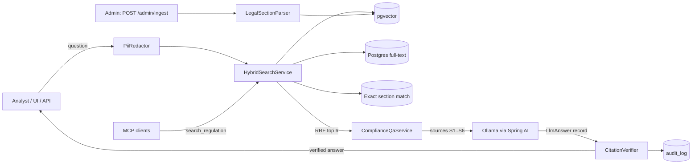

# Comply ZA

**A citation-verified AI assistant for South African regulations, built with Java 21, Spring Boot and Spring AI.**

Ask a question such as *"When may personal information be sent outside South Africa?"* and Comply ZA answers
from the text of POPIA or the FIC Act, citing the section and a word-for-word quote.
Before you see an answer, every quote is checked against the source text in plain code. If a quote doesn't
match, the citation is removed; if none match, the answer is withheld. That way the app doesn't show made-up law.

---

## Features

| Feature | How |
|---|---|
| **Section-aware ingestion** | `LegalSectionParser` splits Acts by Chapter → Section → Subsection (not fixed token windows) and discards the table of contents |
| **Hybrid retrieval** | pgvector semantic search + PostgreSQL full-text search + exact section lookup ("section 72"), merged with Reciprocal Rank Fusion |
| **Structured output** | Spring AI `ChatClient.entity()` maps the model's reply into Java records |
| **Citation verification** | `CitationVerifier` keeps a citation only if the section was retrieved and the quote appears verbatim |
| **POPIA on itself** | `PiiRedactor` strips SA ID numbers (date + Luhn validated), +27 phone numbers and emails before anything reaches the model or the audit log |
| **Audit trail** | Every question, retrieved section, answer and model version is stored in `audit_log` |
| **Evaluation suite** | `EvaluationIT` runs 10 golden POPIA questions and measures citation accuracy and answer relevancy (Spring AI `RelevancyEvaluator`) |
| **MCP server** | `search_regulation` tool exposed over MCP so other AI assistants can query the index |
| **Ops** | Actuator health probes, Prometheus metrics, Flyway migrations, Docker, Render Blueprint, GitHub Actions |

## Architecture



## Tech stack

Java 21 · Spring Boot 3.5 · Spring AI 1.1 · PostgreSQL 17 + pgvector · Flyway · Spring Security ·
Thymeleaf · Micrometer/Prometheus · Testcontainers · JUnit 5 · Docker · Render · GitHub Actions

---

## Run it locally

**Prerequisites:** JDK 21+, Maven 3.9+, PostgreSQL 17 with the pgvector extension, Ollama with `llama3.2` and `nomic-embed-text` pulled.

```bash
# 1. Make sure PostgreSQL (with pgvector) and Ollama are running
ollama list

# 2. Set environment variables
cp .env.example .env          # then edit .env
set -a; source .env; set +a   # (Windows PowerShell: set each with $env:NAME="value")

# 3. Run the unit tests and start the app
mvn test
mvn spring-boot:run
```

Open http://localhost:8080 and sign in as `analyst` / `ANALYST_PASSWORD` (default `analyst-local`).

### Load an Act

Download the English POPIA PDF into `data/popia.pdf` (see `data/README.md`), then:

```bash
curl -u admin:$ADMIN_PASSWORD \
  -F file=@data/popia.pdf \
  -F act=POPIA \
  -F "versionLabel=Act 4 of 2013" \
  -F sourceUrl=https://www.justice.gov.za/inforeg/ \
  http://localhost:8080/admin/ingest
```

Loading the same file again is skipped (SHA-256 check). Loading a new version replaces the old chunks
only after the new ones are stored.

### Ask through the API

```bash
curl -u analyst:$ANALYST_PASSWORD -H "Content-Type: application/json" \
  -d '{"question":"When may a responsible party transfer personal information outside South Africa?"}' \
  http://localhost:8080/api/ask
```

### Run the evaluation

With Docker running, `OPENAI_API_KEY` set and `data/popia.pdf` present:

```bash
mvn verify
cat target/eval-report.json
```

Put your scores here once you have them:

| Metric | Score |
|---|---|
| Citation accuracy (expected section cited) | _run `mvn verify`_ |
| Answer relevancy (`RelevancyEvaluator`) | _run `mvn verify`_ |
| Answered rate | _run `mvn verify`_ |

---

## Endpoints
| Method | Path | Role | Purpose |
|---|---|---|---|
| GET | `/` | ANALYST | Web UI |
| POST | `/api/ask` | ANALYST | Ask a question |
| POST | `/admin/ingest` | ADMIN | Upload an Act (PDF or .txt) |
| GET | `/admin/documents` | ADMIN | Loaded Acts and versions |
| GET | `/admin/audit?limit=50` | ADMIN | Recent questions and answers |
| GET | `/sse` | ANALYST | MCP server (tool: `search_regulation`) |
| GET | `/actuator/health` | public | Health check |
| GET | `/actuator/prometheus` | ADMIN | Metrics |

---

## Deploy to Render

1. Push this repo to GitHub.
2. In Render: **New → Blueprint** → select the repo. `render.yaml` creates the Postgres database and the
   Docker web service in Frankfurt (closest region to South Africa).
3. Fill in the secret values when prompted: `OPENAI_API_KEY`, `ADMIN_PASSWORD`, `ANALYST_PASSWORD`.
4. Wait for the deploy to pass the `/actuator/health` check. Flyway creates the tables and enables pgvector.
5. Load the Acts against the live URL:
   ```bash
   curl -u admin:YOUR_ADMIN_PASSWORD -F file=@data/popia.pdf -F act=POPIA \
     -F "versionLabel=Act 4 of 2013" https://YOUR-SERVICE.onrender.com/admin/ingest
   ```
6. Optional: add `OPENAI_API_KEY` as a GitHub Actions secret so CI runs the evaluation on every push.

**Cost:** Starter web service + Basic-256mb Postgres ≈ USD 14–15/month, plus OpenAI usage.
The free plans work for testing, but the free web service sleeps when idle and the free database expires after 30 days.

---

## Design decisions

- **Why not just `QuestionAnswerAdvisor`?** It does vector search only. Legal questions often reference exact
  section numbers and defined terms, where keyword search is stronger, so retrieval is custom and hybrid.
- **Why verify citations in code?** Asking a model not to hallucinate isn't a control. A substring check is.
- **Why redact before the model?** The app is hosted outside South Africa (Render Frankfurt) and calls an external
  model, which brings in POPIA section 72 (cross-border transfers). Stripping personal information keeps
  questions about the law from carrying personal data abroad.
- **Why section metadata?** Each answer reports which Act versions it used (`asAt`) so users can check currency.

## Limitations and next steps

- Amendments must be loaded manually as new versions.
- The parser targets the layout of SA Acts; regulations and guidance notes may need extra rules.
- In-memory users are for the demo; a real deployment would use OIDC (e.g. Microsoft Entra ID).
- Next: FSCA Conduct Standards, an "ask about my policy document" comparison mode, and Spring AI 2.x upgrade.

## Disclaimer

Comply ZA explains what regulatory text says. It is not legal advice.
